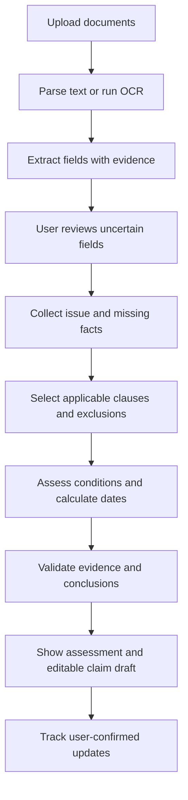

# Claimly — AI Agent Implementation Guide

The implementation choices below are recommendations for Claimly. Links point to supporting documentation and further reading.

## Brief answer

| Your question | Recommendation |
|---|---|
| What is done? | Product scope, user journey, proposed data objects, safety boundaries, and success metrics are specified. Implementation remains. |
| How to implement generally? | Next.js + Supabase Auth/Postgres/private Storage + document processing + a background worker calling an LLM. |
| How to engineer the agent? | Separate extraction, missing-information checks, evidence retrieval, assessment, and drafting into bounded steps. |
| Which models? | Start with GPT-6.1 Sol; benchmark Claude Sonnet 5.5 and Gemini 4 Argon against the same documents. |
| What data? | Receipts, applicable policy versions, correspondence, user-reported facts, and verified source references. |
| How to tune? | Build evaluations first, then improve parsing, prompts, examples, and retrieval. Consider fine-tuning later. |
| How to evaluate? | Measure factual accuracy, evidence support, correct abstention, tool behavior, task completion, cost, and latency. |
| How to store data? | Original files in private object storage; records, evidence pointers, revisions, and case events in Postgres. |
| How to connect the backend? | Authenticated API → queued job → model API → validation → database → UI. Keep credentials server-side. |
| How to prevent hallucinations? | You cannot guarantee elimination. Require evidence, validate outputs, calculate with code, and block unsupported conclusions. |

## 1. What the brief already covers—and what is missing

The brief defines a coherent MVP:

- Upload receipts and warranties.
- Extract editable purchase and coverage records.
- Collect an issue description and missing facts.
- Assess possible coverage with supporting excerpts.
- Prepare an editable claim package.
- Track the case and distinguish potential, approved, and received money.

It also explicitly excludes autonomous filing and broad account integrations.

The main engineering gaps are exact extraction schemas, evidence storage, workflow transitions, authorization policies, failure handling, and an evaluation dataset. Its proposed 12–24 hours is a reasonable target for a narrow demonstration; I would not treat that as a production-readiness estimate. Source: [repository brief](claimly_ai_agent_brief.md).

## 2. How I would engineer the agent

A model is one component. The agent also needs instructions, tools, persistent state, stopping conditions, and validation. Claimly’s predictable stages suit a predefined workflow, with limited model discretion inside each stage. Reading: [Anthropic’s agent architecture guide](https://www.anthropic.com/research/building-effective-agents).

Implement those stages as separate functions:

| Stage | Model responsibility | Backend responsibility |
|---|---|---|
| Intake | Recognize document type and extract fields | Validate uploads; preserve pages and originals |
| Fact collection | Identify material missing information | Store answers and distinguish reported from documented facts |
| Assessment | Match evidence to coverage conditions | Check evidence references and calculate supported deadlines |
| Drafting | Write a clear claim message | Allow only validated facts and verified submission details |
| Tracking | Summarize updates | Enforce status transitions and record confirmed recoveries |

For assessment, represent each coverage condition as `supported`, `contradicted`, or `unknown`. This makes the final conclusion auditable.

Expose narrow tools such as `get_case_documents`, `find_policy_clauses`, and `calculate_deadline`. Enforce ownership and argument validation in backend code. Put limits on tool calls, retries, time, and spending; stop for clarification when essential evidence is missing. Reading: [function calling](https://developers.openai.com/api/docs/guides/function-calling).

## 3. Which models to use

These are current candidates from official catalogs, checked for this answer. Their suitability for Claimly still needs testing.

| Candidate | Suggested use |
|---|---|
| GPT-6.1 Sol — `gpt-6.1-sol` | My starting choice for extraction, assessment, and drafting through one provider |
| GPT-6 Luna — `gpt-6-luna` | Later candidate for cheaper classification or routine extraction, if evaluations pass |
| Claude Sonnet 5.5 — `claude-sonnet-5-5` | Alternative to benchmark for document interpretation and drafting |
| Gemini 4 Argon — `gemini-4-argon` | Alternative to benchmark for multimodal document processing |

Capabilities and available identifiers: [OpenAI catalog](https://developers.openai.com/api/docs/models), [Claude catalog](https://platform.claude.com/docs/en/models/overview), [Gemini catalog](https://aistudio.google.com/docs/models).

Start with one capable model. Establish quality first, then test whether cheaper models can handle individual stages. A stronger model should still return `insufficient_evidence` when the documents do not establish coverage.

For scanned receipts, consider dedicated OCR that preserves text locations and confidence. Amazon Textract, for example, returns blocks containing text, geometry, and processing confidence. That confidence concerns recognition accuracy, not claim eligibility. Reading: [Textract document analysis](https://docs.aws.amazon.com/textract/latest/dg/how-it-works-document-layout.html).

## 4. What data to feed it

Keep three categories separate:

| Category | Claimly examples |
|---|---|
| Evidence | Receipt, applicable warranty, refund terms, return confirmation, correspondence |
| User-reported facts | Failure date, symptoms, damage circumstances, requested remedy |
| System instructions | Output schema, allowed actions, evidence requirements, uncertainty rules |

Each assessment request should receive the relevant case facts, policy conditions and exclusions, and source identifiers. Mark user assertions as reported facts rather than documentary proof.

Preserve policy provenance: merchant, product applicability, effective dates when available, source URL, and retrieval date. A current webpage alone may not establish which terms applied to an older purchase.

For a few short documents, start by passing their complete relevant text. For larger collections, add retrieval-augmented generation (RAG): retrieve evidence from storage and include it in the model request. Combine keyword and semantic search, enforce user/case permissions, and include surrounding clauses so retrieval does not omit an exclusion. Reading: [original RAG paper](https://arxiv.org/abs/2005.11401), [Supabase hybrid search](https://supabase.com/docs/guides/ai/hybrid-search).

Feeding documents into a request does not train the model. Training examples are a separate dataset, discussed below.

## 5. How to tune the agent

I would use this sequence:

1. Create a baseline dataset. Start with 30–50 manually reviewed fictional cases for development; expand before relying on production quality.
2. Fix parsing and context errors first. Missing pages or omitted exclusions cannot reliably be repaired through prompting.
3. Improve instructions. Define coverage labels, evidence requirements, missing-information behavior, and prohibited assumptions.
4. Add a few worked examples. Include covered, excluded, ambiguous, conflicting-document, and unreadable-document cases.
5. Require structured outputs. Use a JSON schema for fields, evidence references, assessment, and missing information.
6. Change one component at a time and compare results against the baseline.

Version prompts, schemas, model identifiers, and retrieval settings so regressions are traceable. Structured outputs help enforce the response shape; they can still contain factual mistakes. Reading: [model optimization](https://developers.openai.com/api/docs/guides/model-optimization), [structured outputs](https://developers.openai.com/api/docs/guides/structured-outputs).

Consider fine-tuning only after repeated, measurable behavior problems remain. Use reviewed input/output examples to teach extraction or response behavior. Keep changing warranty facts in the evidence store. Separate training and evaluation data by document family or template to reduce leakage. Check fine-tuning availability for the chosen model before committing. Reading: [fine-tuning best practices](https://developers.openai.com/api/docs/guides/fine-tuning-best-practices).

## 6. How AI agents are evaluated

Evaluate both the final result and the sequence of actions that produced it.

For Claimly, I would measure:

| Dimension | Example check |
|---|---|
| Extraction accuracy | Are purchase date, amount, currency, and warranty duration correct? |
| Retrieval quality | Were all decisive conditions and exclusions supplied? |
| Grounding | Does each important conclusion have a source that actually supports it? |
| Assessment quality | Does the result match a reviewed reference assessment? |
| Abstention | Does it ask for evidence when the answer is unknown? |
| Tool correctness | Did it select the right tool with authorized arguments? |
| End-to-end success | Can a user produce a usable, supported claim package? |
| Reliability and efficiency | Repeated-run consistency, failure rate, latency, and cost |

Use deterministic checks for dates, amounts, schemas, and permissions. Use human review for ambiguous assessments. An LLM grader can help scale review, but calibrate it against humans and avoid making it the sole judge.

Test adversarial cases too: conflicting policy versions, ambiguous dates, poor scans, missing receipts, instructions embedded in PDFs, and attempts to access another user’s documents. Repeat selected cases because model outputs vary. Track false coverage assertions alongside useful-answer rate; an agent that always says “unknown” is not successful. Reading: [Anthropic’s agent evaluation guide](https://www.anthropic.com/research/demystifying-evals-for-ai-agents), [OpenAI evaluation principles](https://developers.openai.com/api/docs/guides/evaluation-best-practices).

## 7. How to store the data

Keep the brief’s five core objects, then add explicit evidence and processing records:

| Storage | Contents |
|---|---|
| Private object storage | Original PDFs/images and necessary derived artifacts |
| Postgres | Items, coverage, cases, events, corrections, deadlines, amounts |
| Evidence records | Document version, page, exact excerpt, text offsets or bounding box |
| Processing records | Job status, model/prompt version, validation results, cost |
| Optional vector index | Search embeddings linked to authorized source passages |

Store stable object keys rather than expiring signed URLs. Preserve original extraction alongside user corrections. Use integer minor units plus currency for money, and distinguish calendar dates from timestamps.

Apply ownership policies to both database rows and stored files. Background workers using privileged credentials need explicit ownership checks too. Reading: [Supabase row-level security](https://supabase.com/docs/guides/database/postgres/row-level-security), [Storage access control](https://supabase.com/docs/guides/storage/security/access-control).

Plan deletion across originals, extracted text, embeddings, logs, and provider-hosted files. Provider retention is separate from your database settings; inspect the chosen endpoints’ policies. Reading: [OpenAI data controls](https://developers.openai.com/api/docs/guides/your-data).

## 8. How to connect the model to the backend

For the hosted models above, your backend calls a provider API. You do not need to host model weights for the MVP.

Suggested flow:

1. An authenticated endpoint authorizes an upload to private storage.
2. The backend creates a processing job and returns its ID.
3. A worker parses/OCRs the document and calls the model for structured extraction.
4. The backend validates fields and evidence before saving.
5. An assessment endpoint loads the authorized case, selects evidence, and starts assessment.
6. Code checks citations and calculations before releasing the result to the UI.

Keep API keys server-side. Add request limits, timeouts, bounded retries, and idempotency so retries do not duplicate work. Show processing states through polling or realtime updates. Treat model refusals and malformed/incomplete results as explicit job outcomes.

Next.js Route Handlers can implement the endpoints; a durable queue can support document jobs. Reading: [Next.js Route Handlers](https://nextjs.org/docs/app/getting-started/route-handlers), [Supabase Queues](https://supabase.com/docs/guides/queues/quickstart).

## 9. How to reduce hallucinations

Make unsupported claims fail validation before they reach the user. I recommend these layers:

- Evidence first: select exact excerpts before generating conclusions.
- Verifiable references: require document/page references and check that quoted text exists.
- Support checking: verify that the excerpt supports the conclusion; a real quotation can still be misinterpreted.
- Explicit uncertainty: allow missing values and `insufficient_evidence`.
- Deterministic calculations: calculate supported deadlines and amounts in code.
- Conflict handling: surface contradictory evidence and uncertain policy applicability.
- Restricted lookup: accept submission links from supplied documents or verified official sources.
- User review: require confirmation of uncertain facts before preparing the final draft.

Example: a receipt establishes purchase, but does not by itself establish a two-year warranty. Without applicable terms, Claimly should request them rather than infer coverage. Reading: [hallucination reduction guidance](https://platform.claude.com/docs/en/test-and-evaluate/strengthen-guardrails/reduce-hallucinations).

Also treat uploaded documents as untrusted input: their contents must not override instructions or authorize actions. Limit tools and enforce permissions outside the model. This addresses prompt injection, a separate failure mode from hallucination. Reading: [prompt-injection mitigations](https://platform.claude.com/docs/en/test-and-evaluate/strengthen-guardrails/mitigate-jailbreaks).

For the first build, I would prioritize one complete flow: receipt + warranty → reviewed fields → cited assessment → editable claim message → persistent case status. Add reminders, broader retrieval, and model routing once that flow passes your evaluation cases.
