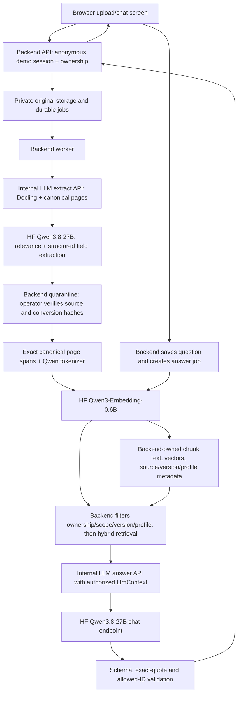

# Claimly upload → Hugging Face → chat

**Resume here:** [Next-chat RAG handoff](rag/NEXT_CHAT_HANDOFF.md) — complete current state, code map, latest hosting direction, verification limits and starter prompt.

This workspace now has a runnable upload/chat integration slice: a browser screen, Backend API, durable worker, stateless internal LLM API, Docling conversion, source-bound review, Qwen token-aware chunks, Hugging Face embeddings, persistent vectors, filtered retrieval and source-cited chat.

**Live connection is pending:** no HF token, deployed inference URLs, PostgreSQL/Supabase credentials or Docker executable were present. Model pages are download repositories, not inference endpoints. The automated integration suite uses explicit HTTP mocks; it is not a live-model accuracy benchmark. No paid endpoint was created.

The user-provided `back/` folder is intentionally untouched: this work is the upload/chat integration slice, not complete-product implementation.

## Quick navigation

- [Full-product integration/deployment prompt](../../PRODUCT_DEPLOYMENT_PROMPT.md)
- [Current deployment prerequisite audit](../../DEPLOYMENT_READINESS.md)


- [Endpoint deployment plan](hf-deployment-plan.json)
- [Pinned Qwen revisions/tokenizer hashes](hf-models.lock.json)
- [Server environment template](../../.env.example)
- [Integration tests](../backend/tests/test_pipeline.py)
- [Legal corpus preparation](rag/README.md)
- [Final parsing experiment](parsing/FINAL_STAGE_1.md)

## Architecture



The LLM service has no database or Supabase credentials. Backend owns storage, source admission, indexing and session authorization. The shared OpenAPI files and categories/statuses remain unchanged. Tokenization runs with each model; no separate tokenization server is needed.

## 1. Configure Hugging Face endpoints

Use [Inference Endpoints](https://huggingface.co/docs/inference-endpoints/index) to provision the two models in `hf-deployment-plan.json`:

1. Embedding: `Qwen/Qwen3-Embedding-0.6B`, pinned revision in the lock, TEI, protected access, full 1024-dimensional normalized vectors. Start with a small CPU instance and benchmark.
2. Chat: `Qwen/Qwen3.8-27B`, pinned revision, vLLM, protected access, JSON-object responses, thinking disabled per request. An 80 GB GPU is an initial unquantized sizing estimate, not a measured requirement. Cap context/concurrency according to the plan. This model is distinct from the embedding model.
3. Copy the embedding prediction URL from the endpoint's generated curl example into `HF_EMBEDDING_URL` EXACTLY. A dedicated endpoint may expose its prediction route at the root; do not guess `/embed`.
4. Put the chat endpoint root or `/v1` base in `MODEL_BASE_URL`. Keep `MODEL_NAME=Qwen/Qwen3.8-27B`, matching the served model name.
5. Set `HF_TOKEN` locally on the server. Never paste it into the browser, source code or chat. Both endpoints must run the same model commits as the tokenizer lock. Record the actual serving image/version when deploying.
6. Warm the endpoints before a live demo. Dedicated endpoints have compute charges; cold starts and endpoint access must be checked explicitly.

Runtime libraries: [TEI Qwen support](https://huggingface.co/docs/text-embeddings-inference/supported_models), [HF vLLM](https://huggingface.co/docs/inference-endpoints/engines/vllm). This code uses direct HTTPS endpoint calls; it does not require Ollama.

## 2. Run locally with hosted models

From the workspace root, using the existing service-local environment:

```sh
services/llm/.venv/bin/python -m pip install -r services/llm/requirements-runtime.lock.txt
cp .env.example .env
```

Fill only `.env` with your endpoint URLs and token. The environment template explicitly enables local development storage. The launcher generates a shared internal-service token for its children if it is unset. Credentials are never stored in the frontend.

The tokenizers/configs have already been downloaded and pinned. To restore them later:

```sh
services/llm/.venv/bin/python -B -m services.llm.prefetch_hf_tokenizers
services/llm/.venv/bin/python -B -m services.llm.check_hf
```

The preflight above performs local checks only. The following command explicitly invokes small live embedding/chat requests and can incur charges:

```sh
services/llm/.venv/bin/python -B -m services.llm.check_hf --live
```

Docling/RapidOCR assets from Stage 1 are reused. To restore them use `services/llm/parsing/prefetch_models.py`; the historical script also restores the old experiment's MiniLM tokenizer, which is not used by this runtime.

```sh
services/llm/.venv/bin/python -B -m services.run_pipeline --local
```

Open `http://localhost:8000`. This starts Backend/UI on 8000, the private LLM API on 8001, and a separate durable worker. `--local` explicitly uses SQLite and private files under `services/backend/.data/`; it is not a silent Supabase fallback. Refresh preserves the demo session and stored messages. Ctrl-C stops the three processes.

## 3. Review an upload before indexing

Upload a real PDF/JPEG/PNG. The worker validates it, converts it using Docling, checks relevance and extracts the shared fields through Qwen. A clear unrelated source is rejected, its original is removed and its unpopulated draft Entry is removed. Invalid files stop before model inference. Incomplete/uncertain sources never enter retrieval.

A readable relevant conversion goes to `needs_review`, not directly into the index. This preserves the source-quality gate from the parsing stage. Operator review is a trusted server-side CLI rather than an unauthenticated browser bypass:

```sh
services/llm/.venv/bin/python -B -m services.backend.review --local --list
services/llm/.venv/bin/python -B -m services.backend.review DOCUMENT_UUID --session-id SESSION_UUID --local
```

Compare the printed canonical text/fields with the original shown in the authenticated browser. After review, approve the exact two hashes shown by that command:

```sh
services/llm/.venv/bin/python -B -m services.backend.review DOCUMENT_UUID --session-id SESSION_UUID --local --approve --source-sha SOURCE_SHA256 --pages-sha PAGES_SHA256
```

An incomplete/semantically unresolved conversion cannot be approved through this quality command. Approval queues an indexing job without rerunning OCR or field extraction. After indexing, click **Check review status**, then ask a question. Citation buttons fetch the original through the authenticated Backend content route.

Pending, unapproved originals are private quarantine, excluded from Vault lists/search and removed after 24 hours. Expired demo sessions are cleaned by the worker. Approved originals are retained until source/session deletion. Run the worker for cleanup to execute.

## 4. Production storage and deployment

For a hosted application server:

- Set `DATABASE_URL` to the server's PostgreSQL/Supabase connection, `SUPABASE_URL`, `SUPABASE_SERVICE_ROLE_KEY`, and an existing private `SUPABASE_BUCKET`. Set `LOCAL_DEV_STORAGE=false`.
- Run `services/llm/.venv/bin/python -B -m services.backend.db`, or apply `services/backend/migrations/001_upload_chat.sql`. The migration enables RLS and revokes anon/authenticated access. Every user operation also filters the resolved demo session on the server.
- Set an explicit random `LLM_SERVICE_TOKEN`, HTTPS reverse proxy, and exact `FRONTEND_ORIGINS`. Keep the internal LLM port private. HF credentials belong only to the model-calling processes; Supabase credentials belong only to Backend/worker.
- Deploy Backend, worker and LLM as separate processes/containers. Mount the prefetched tokenizer and Docling model assets read-only. Never package uploaded documents or secrets into an image.
- `compose.yaml` is a local integration deployment; supply `.env`, a stable service token and the prefetched model directories. It supports explicit local persistent-volume storage or your configured PostgreSQL/Supabase. Docker is not installed in the current workspace, so image builds have not been verified.

The initial vector store uses complete chunk/vector/metadata records in the Backend database and exact dense/lexical ranking over the already-authorized candidate set. A dedicated vector DB is not required for this small corpus. This is not a pgvector ANN implementation; benchmark and add a Backend-owned indexed vector query if volume requires it.

## 5. What is and is not implemented

Implemented: the upload/entry/document/thread/message/job contract slice, private source previews, source-bound review, real Docling path, HF classification/extraction/embedding/chat adapters, exact page-span chunks, normalized vectors, hybrid retrieval, neighboring context, persistent jobs/leases/retries, idempotency, session TTL, rejection cleanup, deletion/citation invalidation and strict schema/evidence checks. Benefits retain unknown usage and uncomputed deadlines.

The UI is a functional integration screen served by Backend, not an implementation of the full Next.js product. Claims, reminders, usage-editing and other unrelated MVP routes remain outside this slice. Existing shared contracts are not extended. Legal kit candidates remain inactive pending version/jurisdiction/applicability review and an agreed legal citation representation; the model is explicitly prevented from filling gaps with prior legal knowledge.

The runtime chunks canonical Page DTO text with exact spans. The richer DoclingDocument remains an internal in-memory conversion artifact; production ingestion does not yet persist a DoclingDocument JSON checkpoint across the unchanged extract HTTP response. Stage 1 checkpoints and HybridChunker experiments remain preserved separately.

## 6. Verification

```sh
services/llm/.venv/bin/python -B -m pytest services/backend/tests/test_pipeline.py -q
services/llm/.venv/bin/python -B -m pytest services/llm/parsing/test_ingestion_lab.py -q
services/llm/.venv/bin/python -B Claimly_Three_Parts/contracts/validate_contracts.py
```

See `services/backend/reports/verification.json` and JUnit files for actual results. Local integration tests use explicitly injected test-only PDF/HTTP providers, with separate real Docling and real Qwen tokenizer checks. No runtime fake provider exists. Missing credentials return `AI_NOT_CONFIGURED`; bad outputs fail instead of becoming a sample answer. These tests do not establish live-model accuracy, cloud availability or production PostgreSQL/Supabase compatibility.

## Hallucination mitigation update

The chat path now abstains deterministically when there are no usable pages or no supporting citations, clears unsupported benefit matches/actions, and prevents a clarification question from bypassing the evidence requirement. Prompt instructions require claim-level grounding, preservation of qualifications and checking dates/amounts/quantities against source passages. Existing quote/ID validation and one-repair limit remain. No extra model call or public contract change was added.

The combined regression suite now has **100 passing tests**. Exact quote matching does not establish semantic entailment or live-model accuracy; those still require reviewed evaluations. See [the current handoff](rag/NEXT_CHAT_HANDOFF.md#hallucination-mitigation). Restart development services after the workspace move and code update.
