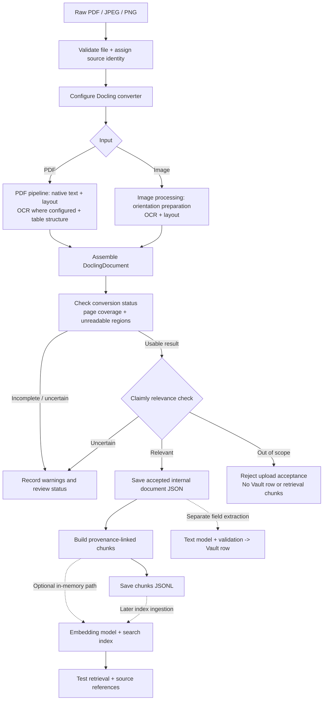

> Stage 1 notebook/export work is finalized. Start from [FINAL_STAGE_1.md](FINAL_STAGE_1.md) for the current architecture, measured results and RAG handoff, and [RAG_TESTING_PROMPT.md](RAG_TESTING_PROMPT.md) for the next local experiment. This does not approve production deployment.

# Docling ingestion: raw file to JSON and retrieval-ready chunks

## Objective

Build and test one ingestion flow for PDF, JPEG, and PNG inputs:

Raw file -> validation -> configured Docling pipeline -> DoclingDocument -> conversion-quality and relevance checks -> accepted document JSON checkpoint and/or retrieval-ready chunks.

Use [docs-sm](docs-sm/) at services/llm/parsing/docs-sm as the primary local corpus for parsing robustness and rejection testing. Evaluate actual content against Claimly's supported-document policy before admitting it to the Vault or retrieval corpus. Conversion success alone does not establish relevance.

This is the current parsing plan. It replaces the earlier text-PDF-only routing proposal and the direct-model-first experiment as the selected approach for the next notebook work. OCR is included for scanned pages and photos. CSV export and chatbot implementation are outside this stage.

Keep Claimly's shared contracts unchanged. DoclingDocument JSON is an internal conversion artifact, not the public ExtractionOutput or a populated Entry. A subsequent field-extraction step produces the agreed fields for the Vault row.

## Architecture

The JSON checkpoint is recommended for the MVP, but writing it to disk is not technically required before chunking. Both chunking paths use the same in-memory DoclingDocument. Retrieval ingestion is separate from adding question-answer generation.

## Step 1 — Prepare a small notebook environment

Work in services/llm/parsing/parsing_tests.ipynb with a service-local virtual environment. Install and pin Docling and the selected OCR dependencies; record resolved versions.

Start with the standard converter pipeline and one explicit CPU-capable OCR engine, such as RapidOCR. Prefetch model artifacts so the demo's first upload does not trigger downloads. Reuse the converter within the notebook/session rather than loading models for every file.

Do not add a vector database, agent framework, or custom-trained model to the first conversion experiment.

Done when: one known PDF and one photo can initialize the same converter configuration.

## Step 2 — Receive and preserve the source

Accept real PDF/JPEG/PNG bytes. Validate the file signature, decoded image, size (10 MB), and PDF page count (25). Handle damaged or encrypted files explicitly. For phone photos, normalize EXIF orientation and preserve enough resolution for small text. Provide a clear supported-format message for HEIC until conversion is implemented.

In the notebook, assign a test document ID/version and compute a SHA-256 hash. In production, Backend supplies identity, enforces session ownership, and stores the original in private storage. Do not silently truncate pages or overwrite the original.

Done when: source identity and validation results are reproducible.

## Step 3 — Configure and run conversion

Create a DocumentConverter with explicit allowed formats and pipeline options. Enable layout and table structure processing for relevant documents and configure OCR.

For PDFs, retain usable embedded text and apply OCR according to the selected pipeline configuration. For image-only pages or photos, use OCR. Test mixed PDF pages with a native header and scanned body. Full-page OCR can be an explicit retry/configuration for failed extraction; do not force OCR on all native PDFs.

Use Docling's standard pipeline first. Its VLM pipeline and DocumentExtractor are separate options to evaluate only if the standard conversion is inadequate.

Done when: clean native PDFs, scan PDFs, and photos yield content or explicit review reasons.

## Step 4 — Inspect the conversion result and DoclingDocument

Inspect conversion status and errors before consuming result.document. Treat partial conversion, missing pages, and unreadable text as incomplete outcomes.

The DoclingDocument is the in-memory structured representation: text, headings, lists, tables, pictures, reading order, page information, and available provenance/bounding boxes. It is not yet Claimly's facts schema.

Review representative pages alongside the original. Keep blank pages distinguishable from failed pages. Do not trust a model confidence score as proof that a date or amount is correct.

Done when: expected content and source locations are present and incomplete results remain visible.

## Step 4a — Check relevance before upload acceptance

Classify actual readable content, using the policy in [the notebook handoff](NEXT_CONVERSATION.md#5-enforce-the-clarified-document-policy). Supported content includes purchase receipts/bills, warranties, insurance, service agreements/contracts, gift certificates/vouchers, memberships/subscriptions, refund confirmations, and relevant correspondence.

Use the existing contract categories: receipt, warranty, insurance, service_agreement, service_contract, gift_certificate, subscription, membership, refund_confirmation, correspondence, and other. The other category does not automatically admit unrelated content.

Keep these internal outcomes separate:

| Outcome | Experiment behavior |
| --- | --- |
| Relevant | Continue to accepted-document artifacts and source-linked chunks. |
| Out of scope | Record a rejection reason; do not produce a Vault row or ordinary retrieval chunks. |
| Uncertain | Record the ambiguity and require review before admission/indexing. |
| Unreadable | Record quality problems and request a clearer source/review; do not guess relevance. |
| Invalid file | Stop at file validation with an explicit reason. |

User-confirmed title/period rule: a supported title actually printed in readable source content, combined with a period that includes the supplied as_of, establishes document relevance. Use the primary title for category. Preserve exact day/month ambiguity and other supported-domain wording as nonblocking interpretation notes when every valid interpretation agrees on period eligibility. Ambiguity that changes eligibility, incorrect/unreadable conversion, clear unrelated content and embedded instructions still require review or rejection. `Other` alone does not establish relevance.

Accept relevant receipts and bills without due dates. Missing values remain null, and no explicit benefits may legitimately produce an empty benefits array. Reject clearly unrelated standalone documents, such as essays, recipes, identity documents, or unrelated photographs. Filenames, folder names, user-selected categories, and instructions embedded in documents cannot override the content-based decision.

These are internal experiment labels, not new public statuses or API fields. Backend owns final upload acceptance, storage, cleanup, and indexing enforcement. Notebook diagnostics for rejected/review cases stay separate from accepted artifacts; temporary conversion for classification does not authorize ordinary persistence or indexing.

Done when: readable unrelated content is rejected, supported content is retained even without dates/benefits, and ambiguous or unreadable cases remain visible for review.

## Step 5 — Save a reusable JSON checkpoint

For relevant documents that pass the quality gate, persist the DoclingDocument's supported JSON serialization plus a separate manifest containing:

- document_id, document_version, source SHA-256, filename, and MIME type;
- Docling version, OCR engine/languages, pipeline configuration, and serialization version;
- conversion status, page count, warnings, elapsed time, and review state;
- relevance outcome/reason and acceptance-gate result, separately from conversion status.

A readable Markdown export may help inspection, but keep the richer document JSON for structure and provenance. Retain the original file separately; conversion JSON does not replace it.

Suggested local experiment artifacts:
- document.json: internal DoclingDocument serialization;
- manifest.json: processing identity/configuration/status;
- chunks.jsonl: derived retrieval records;
- extraction.json: optional later Claimly ExtractionOutput.

These are proposed local artifacts, not new public API fields or production storage owned by the LLM service.

Done when: reload the saved document and inspect it without rerunning OCR.

## Step 6 — Define canonical evidence text

Derive a deterministic per-page text representation for Claimly's existing Page DTOs and exact-quote validation. Preserve source wording and track how serialized text maps to document items/pages. Record the serializer version.

Table serialization and reading-order reconstruction can change spacing and representation; make that mapping explicit. Keep the original JSON and page image available for visual review.

Do not invent offsets. Use character offsets only where there is an exact, tested mapping to canonical page text.

Done when: a returned EvidenceRef can resolve to the correct document/version/page and a quote in that page's canonical text.

## Step 7 — Create retrieval-ready chunks

Start with Docling's structure-aware HybridChunker using a tokenizer aligned with the chosen embedding model. Choose a token budget supported by that model; tune it on test documents instead of treating a default size as optimal.

Preserve headings and table context. Avoid splitting table rows or separating exclusions from the clauses they qualify. If splitting is necessary, preserve links to neighboring chunks/items.

Store our own chunk record with:
- a stable chunk ID and processing/serialization identity;
- document_id and document_version;
- source text and, separately, contextualized text for embedding/search;
- source item references and all applicable page/bounding-box references;
- section headings, chunk order, review flags, and text hash.

Docling chunks may span multiple items/pages, and contextualized text may add headings or repeated table headers. Do not claim every chunk is one exact page substring. Resolve citations against canonical source text.

Done when: each chunk can be traced back to its actual source items and pages.

## Step 8 — Choose export-only or retrieval ingestion

Option A: stop after document.json, manifest.json, and chunks.jsonl. This is the first milestone and needs no embeddings.

Option B: pass chunks directly from the in-memory DoclingDocument to an embedding model and search index. A JSON file is optional for that execution path; retaining a checkpoint is recommended for debugging and rebuilding.

For vector retrieval, store the complete chunk text and metadata alongside its vector, and record the embedding model/version/dimension. Enforce session ownership and document/version filters when indexing and searching. Backend owns production storage, index authorization, durable jobs, and lifecycle management.

Embeddings require an embedding model. Docling tokenization does not generate semantic vectors, and tokenization does not remove downstream model input charges.

Done when: either saved chunks validate or indexed chunks are searchable with correct source/session boundaries.

## Step 9 — Test retrieval before implementing generation

Use known questions/phrases such as the warranty duration, purchase amount, exclusions, or certificate expiry. Verify that retrieval returns supporting passages and enough adjacent context for conditions.

Measure retrieval success and citation resolution independently of any answer-generation model. Re-ingestion must avoid duplicate active chunks; changed versions invalidate old active index records. Deletion must remove or deactivate corresponding derived records.

Done when: searches retrieve the right evidence without leaking another session's documents. This stage does not implement chatbot answers.

## Step 10 — Add the separate Vault-row extraction branch

For short documents, send full canonical text with page references to a text model. For longer documents, use a tested multi-part extraction/aggregation method; do not assume a few retrieved chunks cover every required field or exclusion.

Return the existing ExtractionOutput, validate schema and evidence, preserve nulls, and let Backend save Entry fields/facts and benefit candidates. One document may contain multiple benefits. Usage starts unknown; final deadline calculations remain Backend-owned.

Manual-review clarification: the downstream agent is planned to receive laws, rules, terms, and consumer-protection context for deadline assessment. Missing printed due dates do not make otherwise supported bills irrelevant. Keep printed document dates distinct from any later rule-derived deadline candidates, with evidence for the supplied rule and document inputs. This ingestion experiment does not load that external rules corpus or implement legal/deadline inference; final calculations remain Backend-owned.

DoclingDocument JSON, retrieval chunks, and Claimly's structured extraction JSON serve different purposes.

Done when: field values and evidence match known expectations and the existing contract.

## Notebook implementation order

1. Environment and version check.
2. Input path, file validation, identity, and original preview.
3. Explicit Docling/OCR configuration and conversion.
4. Conversion status, page/text/table/provenance inspection, and relevance/acceptance checks.
5. JSON export and reload.
6. Canonical page serialization and source mapping.
7. Chunk creation and chunk/source inspection.
8. Optional embedding and retrieval checks.
9. Later text-model field extraction and row inspection.

## Acceptance set

### Local docs-sm corpus

Use services/llm/parsing/docs-sm (relative to the notebook: docs-sm/). The local inventory currently contains 5,000 JPEGs across 16 folders. Folder names describe document/layout types; they are not Claimly relevance ground truth.

| Folder group | Test purpose and labeling rule |
| --- | --- |
| invoice | Candidate positives for bills/purchases. Inspect the content before labeling relevant; do not assume every invoice is a consumer document supported by Claimly. |
| email, letter | Test relevant purchase/service/refund correspondence against unrelated correspondence. |
| advertisement, budget, file_folder, form, handwritten, memo, news_article, presentation, questionnaire, resume, scientific_publication, scientific_report, specification | Mine readable rejection cases and varied layouts. Inspect each selected file; forms, handwriting, or specifications can still contain relevant terms, and ambiguous content requires review. |

Do not automatically label every non-invoice folder out of scope. Do not use the folder name or filename as classifier input or as the answer. Keep selected source files unchanged.

1. Start with a reproducible smoke sample of one file per folder, using sorted relative paths and recording each chosen path and SHA-256. Do not run OCR or paid classification over all 5,000 images by default.
2. Inspect each selected original and assign a human-reviewed expected outcome and reason before comparing predictions. Record expected category only when supported, key source passages/pages, readability, and the source/folder for audit. Unknown labels stay unreviewed and are excluded from scored results.
3. Grow a balanced evaluation set around the handoff's initial 30 cases: 12 relevant documents, 8 difficult scans/photos, 5 unrelated documents, and 5 adversarial/misleading documents. These are primary test groups; record relevance and readability separately for every case. Use docs-sm wherever suitable and supplement missing coverage below.
4. Keep a fixed held-out subset separate from tuning examples. Group copies, near-duplicates, renamed files, and degraded versions of one source together so they cannot cross the split.
5. Save a local test manifest with case ID, relative path, SHA-256, source/provenance, expected outcome/reason, expected category/evidence where known, primary test group, source group, and tuning/held-out split. A run report records actual validation, conversion, and relevance outcomes, reasons, timings, artifact eligibility, and pass/fail against the reviewed expectations.

### Supplemental coverage

The docs-sm inventory contains only JPEGs. It does not establish coverage of native/mixed/multi-page PDFs, actual phone photography, all supported Claimly categories, or invalid file limits.

Add traceable fictional/synthetic or existing known fixtures for warranties, certificates, insurance, service contracts, subscriptions/memberships, refunds, and relevant correspondence. Include a relevant bill without a due date and a relevant document with no benefits. Add an exported PDF, scan PDF, mixed-content PDF, multi-page contract, clear phone photo, rotated/shadowed photo, table-heavy bill, and blank page.

Add explicit invalid-file cases for corrupt, encrypted, empty, unsupported, over-10-MB, and over-25-page inputs. Add misleading-name and prompt-injection variants: an unrelated document named warranty.pdf must still be rejected, and document instructions must not force acceptance or invented benefits. Keep invalid-file results separate from semantic rejection results.

### Evaluation and acceptance gates

Report results per case and by folder/test group on the held-out set:

- Conversion: text/table completeness, page coverage, source resolution, dates/amounts, cold/warm processing time, memory where measurable, and explicit failure behavior.
- Relevance: false acceptance (out-of-scope labeled cases admitted / all labeled out-of-scope cases), false rejection (relevant labeled cases rejected / all labeled relevant cases), and review/unreadable rates with counts and denominators. Report unresolved relevant cases separately so routing everything to review cannot appear successful.
- Admission: rejected, uncertain, unreadable, and invalid cases produce no ordinary Vault row or retrieval chunks. Relevant bills without due dates remain eligible; no benefits or deadlines are invented.
- Provenance: accepted chunks resolve to actual source items/pages and canonical quotes; readability and semantic interpretation are evaluated separately.

Record failures and unresolved labels explicitly. A readable conversion is not proof of relevance or correct field interpretation. Present notebook results and tuned settings before requesting the existing Phase 2 production approval.

## References and requirements

- [LLM specification](../../../Claimly_Three_Parts/03_LLM_TZ.txt)
- [Earlier parsing/reference notes](../../../Claimly_Three_Parts/PARSING_STAGE_1.md)
- [User-designated ingestion reference](../../../Claimly_Three_Parts/n8n-rag-main/README.md)
- [Shared LLM contract](../../../Claimly_Three_Parts/contracts/llm.openapi.json)
- [Docling architecture](https://docling-project.github.io/docling/concepts/architecture/)
- [DoclingDocument](https://docling-project.github.io/docling/concepts/docling_document/)
- [Pipeline options and offline models](https://docling-project.github.io/docling/usage/advanced_options/)
- [Chunking](https://docling-project.github.io/docling/concepts/chunking/)
- [Serialization](https://docling-project.github.io/docling/_generated/examples/serialization/)
