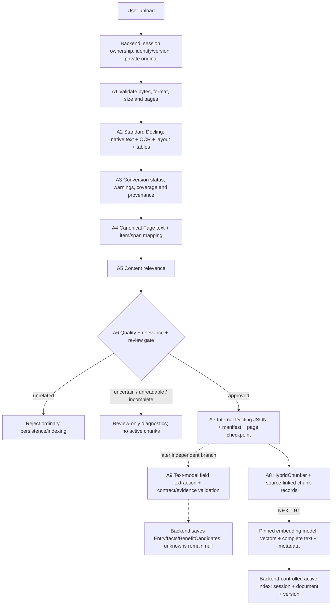
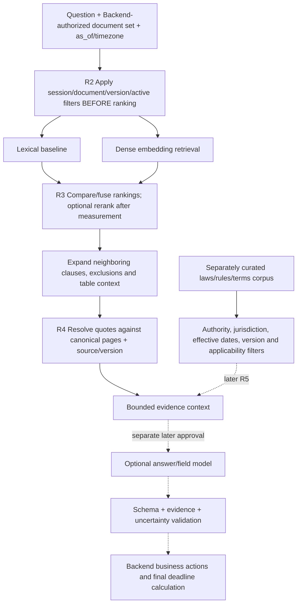

# Claimly — Stage 1 completion and RAG handoff

**Snapshot:** 2026-11-15, Asia/Almaty. **Status:** the local notebook/export experiment is finalized with explicit failures and review cases. Production ingestion, semantic retrieval, answer generation and the legal/rules agent are not implemented or approved by this handoff.

## Navigate

- [1. What this stage does](#1-what-this-stage-does)
- [2. Full system architecture](#2-full-system-architecture)
- [3. Processing blocks](#3-processing-blocks)
- [4. Measured results](#4-measured-results)
- [5. Uploaded current-date examples](#5-uploaded-current-date-examples)
- [6. Relevance, dates and rules](#6-relevance-dates-and-rules)
- [7. Reusable RAG package](#7-reusable-rag-package)
- [8. Step-by-step RAG experiment](#8-step-by-step-rag-experiment)
- [9. Tuning and acceptance gates](#9-tuning-and-acceptance-gates)
- [10. Next-agent implementation prompt](#10-next-agent-implementation-prompt)
- [11. Folder cleanup and reproduction](#11-folder-cleanup-and-reproduction)
- [12. Remaining limits](#12-remaining-limits)
- [13. Official references](#13-official-references)

## 1. What this stage does

The implemented local flow is:

`PDF/JPEG/PNG bytes → validation and source identity → configured standard Docling + CPU RapidOCR → status/page/provenance checks → canonical pages → content relevance → source-bound quality review → internal JSON checkpoint + retrieval-ready chunks`.

Docling uses pretrained conversion/OCR models; the notebook adds a transparent relevance-rule baseline. This is an automated processing experiment, not a newly trained unsupervised model. Manual labels are evaluation evidence and do not train a model automatically.

Implemented:

- A service-local environment, full resolved dependency lock, and hashes of prefetched model/tokenizer assets.
- Actual PDF/JPEG/PNG byte validation, the 10 MiB and 25-page limits, encryption/corruption handling, HEIC guidance, EXIF preparation, SHA-256 and reproducible test UUIDs.
- Reused standard Docling converter with English ONNX Runtime RapidOCR, layout, accurate tables, CPU/four threads and a 120-second document timeout.
- Default OCR that retains usable native PDF text; a separate full-page OCR retry configuration, with distinct processing identity.
- Explicit conversion warnings, page coverage, blank/unreadable distinction, source item/bounding-box checks, and incomplete-content review.
- Deterministic `claimly-pages-v2` serialization; exact internal span mappings; unchanged public Page/EvidenceRef shapes.
- HybridChunker with the pinned MiniLM tokenizer and an initial 240-token contextualized budget, stable IDs, full text, headings, item/page/box references and neighboring chunks.
- Atomic, integrity-checked local checkpoints and JSON reload/chunk rebuild without rerunning OCR.
- Raw-image/text/token HTML and notebook inspection; durable preservation of all 12 submitted human reviews.

Not implemented: public ExtractionOutput/Vault-row extraction, embeddings, a production database/search index, authenticated retrieval, answer generation, chatbot UI, or legal/deadline inference. Backend remains responsible for real identity, sessions, ownership, storage, durable jobs, lifecycle and final deadline calculations. Shared contracts are unchanged.

## 2. Full system architecture

### 2.1 Document arrival and indexing



Solid conversion/checkpoint paths are implemented in the local experiment. Backend/production wiring, field extraction and dotted indexing paths are architectural targets.

### 2.2 Retrieval and later reasoning



The private consumer-document corpus and authoritative-rule corpus are separate trust domains. Generated test laws must never be presented as real authority. No external legal corpus is loaded in this stage.

## 3. Processing blocks

| Block | Input → output | Implemented owner/reference |
|---|---|---|
| A1 — validation | Original bytes → Source identity or explicit invalid-file reason | `ingestion_lab.validate_bytes` |
| A2 — conversion | Prepared bytes → conversion result/DoclingDocument | `make_converter`, `convert` |
| A3 — quality | Status/errors/warnings/page items → structural pass or review | `quality_gate` |
| A4 — evidence | Docling items → canonical Page DTOs and exact internal item spans | `canonical_pages`, `evidence_resolves` |
| A5 — relevance | Actual canonical content → relevant/out-of-scope/uncertain/unreadable | `classify_content` |
| A6 — review gate | Conversion + relevance + source/canonical-bound review → export eligibility | `ingest`, `review_and_export` |
| A7 — checkpoint | Approved document → JSON, manifest, pages and visual references | Atomic checkpoint export/reload |
| A8 — chunks | Same in-memory document → stable source-linked JSONL records | `build_chunks` |
| A9 — field extraction | Full canonical pages or tested multi-part aggregation → existing ExtractionOutput | Planned; no model adapter configured |
| R1–R4 — retrieval | Approved chunks → filtered supporting passages and resolvable references | Next notebook stage |
| R5 — rules/reasoning | Authorized evidence + supplied applicable rules → supported analysis | Later, separately tested stage |

<details><summary>Representation boundaries</summary>

- `document.json`: internal Docling structure/provenance. It is not a Vault row.
- `pages.json`: canonical Page list plus internal mapping metadata. Evidence quotes resolve here.
- `chunks.jsonl`: source text and separate contextualized search text, with full source references.
- `manifest.json`: source/configuration/version/review/integrity record.
- `ExtractionOutput`: existing public field-extraction contract; not produced by this stage.
- Embeddings: later numerical vectors. Tokenization is not embedding and does not remove downstream charges.

</details>

## 4. Measured results

See [`reports/stage-summary.json`](reports/stage-summary.json), [`reports/baseline-55.json`](reports/baseline-55.json), [`reports/generated-samples.json`](reports/generated-samples.json), and [`reports/review-comparison.json`](reports/review-comparison.json).

| Evaluation | Measured result | Interpretation |
|---|---|---|
| Bounded regression set | 55 cases: 16 corpus samples + 30 core synthetic + blank + eight invalid | The 5,000-image corpus was not OCR-processed wholesale |
| Conversion | 47 non-invalid cases returned Docling success | Success alone does not establish completeness or relevance |
| Local admission | 19 synthetic checkpoints, 21 chunks | All supported basic fixture types exercised |
| Invalid inputs | Eight stopped before conversion | Empty/corrupt/encrypted/unsupported/HEIC/size/page-count cases explicit |
| Regression routing | 20 relevant, 14 out of scope, 11 uncertain, two unreadable, eight invalid | One relevant rotated image remains unresolved by source-quality review |
| Human review | 12 exact browser reviews preserved; five matching predictions, seven differences | Not blind held-out accuracy; predictions were visible |
| Newly uploaded examples | Three inspected; certificate accepted, blank PNG and receipt withheld | Title-plus-period policy and source-quality results below |
| Paid calls / embeddings | Zero / zero | No semantic retrieval metrics claimed |

The current user-confirmed policy accepts a supported title actually printed in source content together with a period that includes the explicit evaluation date. The primary title determines category; exact date format and other supported-domain wording remain nonblocking notes when they cannot change window eligibility. All valid date interpretations must agree. Blank/incorrect OCR, unrelated content and injection checks still apply.

The receipt rule also recognizes a dated purchase slip without a literal “Receipt” title only when subtotal, total and a consistent payment amount provide independent purchase markers. It does not use brand/file/folder names. Prompt injection, conflicting content, incomplete conversion and source-quality failures still block automatic admission. This remains an experimental classifier.

The test suite covers validation, identity, EXIF, exact evidence, partial results, missing characters/boxes, logged warnings, chunk budgets/IDs, immutable review preservation, unsafe HTML, dropdown options and receipt markers. The exact final test count is recorded in [`reports/test-results.xml`](reports/test-results.xml).

## 5. Uploaded current-date examples

Original files remain unchanged under repository-root `generated-test/`. Expectations were proposed by visual inspection before conversion, all in the tuning set; they are not claimed as independently human-reviewed ground truth.

| Source | Actual content and dates | Conversion/admission finding |
|---|---|---|
| `212_Warranty_simple_brown_landscape_3aee88aa90.jpg` | Warranty Certificate; accident/sickness insurance wording; printed `12.02.2024`–`12.02.2027` | Accepted as `warranty`: the primary Warranty Certificate title matches the supported list and both day/month interpretations of the printed period include 2026-11-15. One source-linked chunk is admitted. Exact-format, insurance-wording and template/provenance notes remain visible for later field interpretation, without blocking document relevance. |
| `auto-service-receipt-2026-11-15.png` | Every RGBA pixel is white | Valid, blank PNG. Filename date is not evidence. No text/date/benefit invented; no chunks. |
| `target-receipt-2026-11-15.jpeg` | Synthetic/watermarked purchase receipt; printed `11/15/2026`, total `$65.77`, savings `$0.88` | Default OCR preserved required passages but logged an empty OCR region. Full-page retry removed that warning but reordered savings into `880$`. Content is relevant; source-quality review fails, so no ordinary chunks. |

The receipt's visible item amounts also do not reconcile to its printed subtotal. Preserve printed figures and annotate the synthetic fixture issue; do not invent missing purchases, loyalty value, a return window or an unused benefit. Do not correct canonical text silently—store any independently verified correction as a distinct, versioned derivative.

Inspect [`generated_test_review.html`](generated_test_review.html), the diagnostic baseline/final directories under `runs/`, or the uploaded-samples notebook. The final report records the separate baseline and retry outcomes; the original 12 reviews are untouched.

## 6. Relevance, dates and rules

Keep four distinct questions:

1. **Readable?** Can conversion preserve enough of the actual source, including important numbers and conditions?
2. **Supported content?** Does it describe a receipt, warranty, insurance, service agreement/contract, certificate, membership/subscription, refund, or relevant correspondence?
3. **Dates correct and meaningful?** Which date is purchase, service, printed expiry, coverage period, claim deadline or something else? Ambiguous formats stay unresolved.
4. **Applicable at the supplied as_of?** A recent issue date does not prove an active benefit; an old receipt can remain supporting evidence. Unknown anchors, usage or renewal information remain unknown.

The downstream agent is planned to receive laws, rules, terms and consumer-protection material. It may assess rule-derived deadlines only using supplied applicable sources and documented inputs. Missing printed due dates do not make supported bills unrelated. Preserve printed dates separately from later rule-derived candidates. Backend keeps final deadline calculations under the unchanged contract. The current experiment contains no live legal/rules inference.

Human-review questions still open:

- Three invoice notes primarily verify OCR numbers/dates; confirm whether those corporate/reprint documents satisfy consumer relevance separately.
- The bill's submitted label remains `uncertain`; the later deadline-context clarification is recorded without silently changing that label.
- Unreadability alone cannot establish out-of-scope content. Keep readability and semantic relevance separate.

## 7. Reusable RAG package

**Legal-corpus preparation update (2026-11-15):** a separate candidate kit is now present under `../rag/claimly_legal_corpus_kit/`. Its local audit covers 350 federal and 987 state records / 1,877 legacy chunks; 1,264 exceed the planned 256-token embedding limit. The [RAG preparation guide](../rag/README.md) and updated implementation prompt define source/version/applicability review, token-aware rebuilding, and separate document/legal retrieval. No legal index or chatbot has been implemented. This supplements the finalized parsing results.

Start from [`rag-handoff/index_input_manifest.json`](rag-handoff/index_input_manifest.json), not arbitrary files discovered under `runs/`.

- **20 verified checkpoints / 22 chunks** retained for reproducibility and robustness comparisons.
- **12 default-active source groups / 13 chunks**, one primary source per group; the multi-page contract is preferred to its shorter variant.
- Duplicate/degraded variants are retained but inactive by default.
- The bill source group is withheld from the default index pending reconciliation of the submitted manual label and downstream deadline note.
- The uploaded warranty certificate is active under the title-plus-period policy. The blank PNG and receipt with an incorrect OCR savings value remain excluded; their diagnostic evidence is retained for testing.
- [`rag-handoff/retrieval_questions.json`](rag-handoff/retrieval_questions.json) contains 12 quote-validated tuning questions. These are authored fixture checks, not a held-out retrieval benchmark.
- `demo_session` assignments are test fixtures, not production authorization. Backend must supply real session/document/version permissions.

Every checkpoint can be checked without OCR using `finalize_stage.verify_checkpoint`. Source originals are preserved locally under `rag-handoff/sources/`; large/raw corpora, model weights and disposable outputs are ignored for Git. Relative paths are used in handoff/report displays.

## 8. Step-by-step RAG experiment

| Step | Build and verify | Done when |
|---|---|---|
| 1. Freeze inputs | Read this handoff, plan, shared contracts and n8n reference. Verify checkpoint hashes and admission/review state. | Unapproved sources cannot enter the active corpus |
| 2. Separate test data | Keep source families/duplicates together; reserve new source groups and questions as genuinely held out. Resolve manual label questions. | Tuning data cannot leak into reported held-out results |
| 3. Establish lexical baseline | Search full source/context text with a small local lexical scorer. Preserve versions and neighboring clauses. | Known amounts, names, dates and exclusions retrieve supporting pages |
| 4. Add one embedding model | Explicitly prefetch/pin MiniLM weights/revision; reuse the model. Record actual dimension, normalization and token limits. | Actual vectors are generated; text/metadata are retained with each vector |
| 5. Minimal local index | Start with in-memory NumPy vectors plus metadata; persist an explicit local snapshot if useful. | No vector database/framework is required for this scale |
| 6. Enforce boundaries first | Filter allowed session/document/version/active status before ranking, for lexical and vector paths. | Cross-session and stale/deleted results are always absent |
| 7. Compare retrieval modes | Lexical, dense, and a simple fusion; reranking only if measured failures justify it. | Evidence recall/ranking and latency are reported independently of answers |
| 8. Resolve citations | Return source IDs/version/pages/items; validate quotes against canonical pages. Expand neighboring exclusions/table context. | Every cited passage resolves; contextualized text is never falsely called an exact page quote |
| 9. Test lifecycle | Repeat ingestion, change version, delete/deactivate source, corrupt checkpoint, and retry incomplete work. | No duplicate active chunks, stale records or partial-success indexing |
| 10. Add authoritative context separately | Curate rule sources with authority, jurisdiction, effective period/version and applicability metadata. Use explicit fictional rules only in a test namespace. | Missing/conflicting authority produces an insufficient-evidence outcome |
| 11. Tune on tuning data | Compare chunk budgets, k, fusion, score threshold and adjacent context. Freeze settings before held-out evaluation. | A justified configuration beats the baseline without degrading hard boundary tests |
| 12. Report and stop | Save the notebook, case/query reports, settings, costs and limits. | Present evidence for approval; do not silently deploy production or build a chatbot |

Field extraction and later answer generation remain separate branches. A few retrieved chunks must not be assumed to contain every fact or exclusion needed for a Vault row.

## 9. Tuning and acceptance gates

**Hard correctness gates:** zero session leaks, zero inactive/stale/deleted versions, zero unapproved-source indexing, 100% citation identity/page/quote resolution, no silent embedding truncation, complete stored chunk text, and repeat-ingestion idempotency. A failure blocks promotion regardless of average recall.

**Retrieval measurements:** supporting-source Recall@1/3/5, MRR, supporting-clause recall including exclusions, wrong-document matches, no-evidence false positives, latency, peak memory and embedding calls/tokens/cost where applicable. Always show counts and denominators per test group.

An initial target such as Recall@5 ≥ 0.90 is a proposed experiment target, not an achieved result. Tune refusal/score thresholds using explicit negative queries; cosine similarity is not proof of truth or legal applicability. Human-reviewed held-out denominators must be nonzero before claiming accuracy. Report unresolved relevant cases separately so routing everything to review cannot look successful.

Start from the current 240-token contextualized budget. Compare alternative budgets only within the actual embedding model limit, counting headings/repeated table context and special tokens. Rebuild chunks from saved Docling JSON; do not rerun OCR merely to tune retrieval.

## 10. Next-agent implementation prompt

The complete copy/paste prompt is [`RAG_TESTING_PROMPT.md`](RAG_TESTING_PROMPT.md). It authorizes a **local RAG retrieval-testing notebook**, not production implementation, legal advice, or a chatbot.

<details><summary>Short invocation</summary>

```text
Read services/llm/parsing/FINAL_STAGE_1.md and services/llm/parsing/RAG_TESTING_PROMPT.md.
Implement and execute the next-stage local retrieval-testing notebook using only the approved RAG handoff inputs. Preserve the source/review boundaries, evaluate lexical vs dense retrieval and citation resolution, tune only on tuning data, report held-out results honestly, and stop before production deployment or answer/chatbot implementation.
```

</details>

## 11. Folder cleanup and reproduction

The workspace does not currently contain a root `.git` repository, so “GitHub-ready” means source/docs/tests/locks/manifests and a portable handoff with appropriate ignore rules; no commit, push, or repository creation is implied.

Keep:

- Core scripts/tests, pinned dependencies/model hashes, canonical final report and the RAG implementation prompt.
- `manual_reviews.json` unchanged, `manual_review_notes.json`, evaluation manifests and portable measured reports.
- Executed notebooks and current HTML inspection views needed for review/next-stage work.
- `rag-handoff/`, its verified checkpoints, source group/default-active decisions and tuning query references.
- Original `docs-sm/`, `generated-test/`, service environment/model assets and the existing graph tool environment locally, because they support continued evaluation.

The cleanup ledger in [`reports/cleanup.json`](reports/cleanup.json) records exactly what was removed or archived. Disposable Python/pytest/notebook/OS caches and duplicate scratch runs/tool installation are removed; source corpora, user reviews, model weights and required RAG evidence are preserved. Historical direct-model notebook cells are archived rather than discarded.

Reproduce from the repository root, restoring local source corpora where needed:

```sh
python3 -m venv services/llm/.venv
services/llm/.venv/bin/python -m pip install -r services/llm/parsing/requirements.lock.txt
services/llm/.venv/bin/python services/llm/parsing/prefetch_models.py
services/llm/.venv/bin/python services/llm/parsing/build_fixtures.py
services/llm/.venv/bin/python services/llm/parsing/run_lab.py --output runs/final
services/llm/.venv/bin/python services/llm/parsing/run_generated_tests.py --force-full-page-ocr
services/llm/.venv/bin/python services/llm/parsing/finalize_stage.py
services/llm/.venv/bin/python -m pytest services/llm/parsing/test_ingestion_lab.py -q
```

`build_fixtures.py` recreates the initial proposed manifest; it does not overwrite the separate submitted human review export. Model/tokenizer prefetch is an explicit network step; conversion/testing use local weights. The original `generated-test/` bytes must match the frozen manifest; changed inputs need a new source identity/version, not silently reused labels.

## 12. Remaining limits

- Prototype relevance rules remain conservative and incomplete; no independent human-labeled held-out accuracy is claimed.
- No genuine phone-camera coverage is established; simulated photos and user-generated images are identified as such.
- The rotated synthetic warranty and the newly uploaded receipt still have source-quality failures despite readable text.
- Multi-page table/cell mapping requires explicit review; table decoder warnings are not ignored.
- The generated certificate is accepted using its primary Warranty title and relevant period. Insurance wording and exact day/month ambiguity remain later interpretation notes; no real-world coverage determination is implied.
- Blank auto-service input needs a nonblank replacement; no content can be recovered from uniformly white pixels.
- External legal/rules sources, jurisdiction/effectivity testing and semantic retrieval have not been supplied/implemented.
- Full field extraction, final deadlines, usage state, production session/index lifecycle and chatbot answers remain outside this finalized stage.

## 13. Official references

The checkpoint/chunking approach follows Docling's [chunking concepts](https://docling-project.github.io/docling/concepts/chunking/) and [offline/model configuration](https://docling-project.github.io/docling/usage/advanced_options/). HybridChunker keeps document structure while applying a tokenizer budget.

The proposed first embedding baseline is [all-MiniLM-L6-v2](https://huggingface.co/sentence-transformers/all-MiniLM-L6-v2), whose model card describes 384-dimensional embeddings. The next notebook must load actual weights and record the observed output dimension. Sentence Transformers documents [pinned revisions/local loading](https://www.sbert.net/docs/package_reference/sentence_transformer/model.html) and [semantic search](https://www.sbert.net/docs/package_reference/util/retrieval.html). These are implementation references, not measured retrieval results for Claimly.

The user-designated `Claimly_Three_Parts/n8n-rag-main/` supplies ingestion/change-tracking examples. Claimly's specifications and existing contracts govern interfaces, access boundaries and evidence behavior; do not copy the reference's truncated-text metadata pattern into the index.
