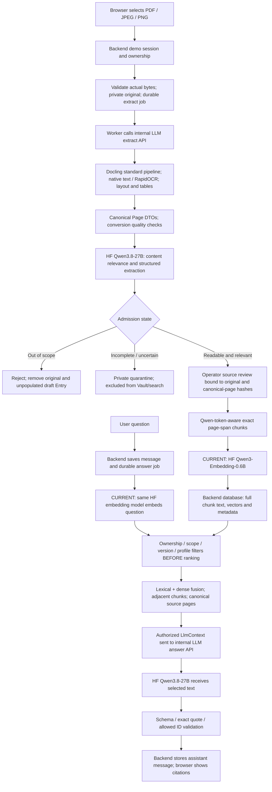
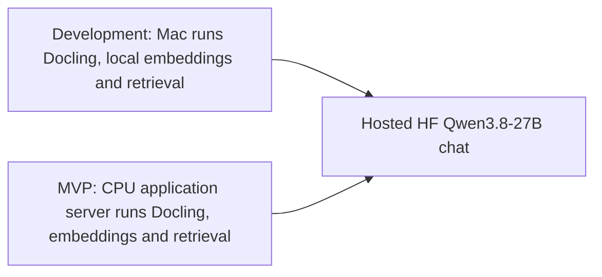

# Claimly RAG and Hugging Face — next-chat handoff

> **Full-product planning update:** the user has now requested a complete-product integration/deployment prompt. See [PRODUCT_DEPLOYMENT_PROMPT.md](../../../PRODUCT_DEPLOYMENT_PROMPT.md) and [DEPLOYMENT_READINESS.md](../../../DEPLOYMENT_READINESS.md). `back/` was inspected for this full-product readiness audit, but no product code was modified. A blocking frontend-isolated-session versus Backend-shared-workspace mismatch was confirmed. The earlier pipeline-only scope remains historical context; invoking the full-product prompt explicitly selects product integration.

Recorded: 2026-11-15. This is the current starting point. Read the implemented code and verification report before making changes. Older parsing/retrieval prompts describe earlier milestones and must not be mistaken for the current architecture.

## Navigation

- [Scope and user decisions](#scope-and-user-decisions)
- [Implemented pipeline](#implemented-pipeline)
- [Latest hosting direction](#latest-hosting-direction)
- [Code map](#code-map)
- [Models and tokenization](#models-and-tokenization)
- [Two evidence collections](#two-evidence-collections)
- [Source admission and review](#source-admission-and-review)
- [Hallucination mitigation](#hallucination-mitigation)
- [Verification and limits](#verification-and-limits)
- [Run and configure](#run-and-configure)
- [Next-chat work order](#next-chat-work-order)
- [Starter prompt](#starter-prompt)

## Scope and user decisions

1. The immediate work is the **upload-to-chat integration slice**, not the complete Claimly product. A small browser integration screen was built under `services/backend/web/`; it is not the full Next.js frontend.
2. The user supplied `back/` **if and only if working on the complete product**. We told them this is a pipeline slice and left that folder unchanged. Do not use this handoff to infer permission to alter or stitch together `back/`. If the user explicitly expands to complete-product work, inspect the existing product there before adding parallel implementations.
3. Keep displayed paths relative. Do not show the user's global home-directory prefix.
4. Shared contracts remain unchanged. DoclingDocument JSON, internal retrieval records, ExtractionOutput and the populated Vault Entry are different artifacts.
5. Selected models: **Qwen/Qwen3-Embedding-0.6B** for embeddings; **Qwen/Qwen3.8-27B** for classification, structured extraction and chat. These are distinct models and tokenizers.
6. Latest recommendation after discussing the user's M2 Pro / 16 GB Mac: **local embeddings during development, application-server CPU embeddings for an MVP, hosted chat on Hugging Face**. This is the intended next direction to evaluate. The actual code still calls Hugging Face for BOTH embeddings and chat; no local embedding adapter or local embedding inference has been implemented.
7. The supplied Hugging Face URLs were MODEL REPOSITORY pages, not deployed inference endpoint URLs. No HF token, live endpoint URLs, PostgreSQL/Supabase credentials, Node/npm or Docker executable were available when this slice was built.
8. Do not create paid resources, run paid inference or claim cloud deployment without the required explicit action/configuration. Never request or expose tokens in chat; configure them locally on the server.

## Implemented pipeline



Backend owns identity, sessions, private originals, admission, persistent jobs, indexing and retrieval authorization. The LLM service is stateless and receives supplied context only. It does not receive database/Supabase credentials. The worker legitimately holds both storage and model credentials to orchestrate the pipeline. Browser code receives only its demo-session token.

The public API keeps existing `2.0.0` DTOs/statuses. The implemented subset covers sessions, entry create/get/list, document upload/get/content/analyze/delete, thread create/list, messages, job polling and benefit listing. Claims, reminders and other full-product operations are not implemented in this slice.

## Latest hosting direction



**This diagram is the recommendation, not current implemented behavior.** Current `HFClient` exposes both `embed()` and `structured()` and all production model calls are remote.

To adopt it, add an interchangeable local embedding implementation using the same pinned Qwen embedding checkpoint, correct query instructions, pooling, normalization and 1024-dimensional vectors. Download the actual embedding weights explicitly; only tokenizer/config assets are currently prefetched. Load the model once, use bounded batches, and benchmark CPU versus Apple MPS. Do not assume performance or reuse an index across incompatible embedding identities. Chat stays behind the existing HF provider adapter.

There are TWO meanings of hybrid here: deployment hybrid = local/server embeddings plus hosted chat; retrieval hybrid = lexical plus dense ranking. Keep them distinct.

A local 27B chat model is constrained by this Mac's memory; hosted chat is the proposed route. Dedicated HF endpoints incur compute charges and may cold-start after scaling to zero. The 80 GB GPU mentioned in the deployment plan is an initial unquantized sizing estimate, not a measured requirement or a provisioned resource.

## Code map

Paths below are relative to the workspace root.

| File | Responsibility |
|---|---|
| `services/run_pipeline.py` | Local launcher for API, internal LLM and separate worker; per-process secret isolation |
| `services/envfile.py` | Environment-file loading without shell execution or secret printing |
| `services/backend/api.py` | Contract-compatible upload/chat subset, session checks, idempotency, original-source delivery and deletion |
| `services/backend/config.py` | Backend-only configuration |
| `services/backend/db.py` | Explicit SQLite development mode or PostgreSQL, durable jobs/leases, objects, vectors and idempotency |
| `services/backend/storage.py` | Backend-owned private local/Supabase originals |
| `services/backend/worker.py` | Extraction orchestration, source gate, atomic indexing, filtered retrieval and answer persistence |
| `services/backend/review.py` | Trusted source/hash-bound quality-review CLI |
| `services/backend/maintenance.py` | Expired sessions, unapproved quarantine and deletion-tombstone cleanup |
| `services/backend/llm_client.py` | Real internal extract/answer HTTP client, contract validation |
| `services/backend/web/` | Standalone browser integration screen; safe text rendering and original-source previews |
| `services/backend/migrations/001_upload_chat.sql` | Production schema, RLS and denied browser DB access |
| `services/llm/app/main.py` | Stateless protected internal extract/answer API |
| `services/llm/app/processing.py` | Docling, relevance classification, structured field extraction and grounded answering |
| `services/llm/app/hf.py` | HF TEI/chat clients, local tokenizer budgets, embedding identity, output checks and one JSON repair |
| `services/llm/app/contracts.py` | Existing schema, citation and allowed-object validation |
| `services/llm/app/body_limit.py` | Actual request-stream size bound |
| `services/llm/app/config.py` | Model/provider configuration and locked revisions |
| `services/llm/rag/runtime.py` | Exact page-span chunks, hashes/neighbors, lexical/dense fusion |
| `services/llm/parsing/ingestion_lab.py` | Reused validated byte handling, Docling converter and canonical serializer |
| `services/llm/prefetch_hf_tokenizers.py` | Explicit public tokenizer/config prefetch; no chat/embedding weights |
| `services/llm/check_hf.py` | Local preflight; `--live` explicitly invokes small paid requests |
| `services/llm/hf-models.lock.json` | Model commits and tokenizer/config file hashes |
| `services/llm/hf-deployment-plan.json` | Reviewable endpoint plan; not provisioned |
| `.env.example`, `compose.yaml`, `services/llm/Dockerfile` | Configuration and deployment preparation |
| `services/backend/tests/test_pipeline.py` | Explicit provider mocks plus real Docling/tokenizer checks |
| `services/backend/reports/verification.json`, `tests.xml` | Actual verification evidence and limits |

The detailed [integration guide](../README.md) contains setup and source-review commands. Read code before refactoring; do not recreate these components.

## Models and tokenization

Pinned model commits:

| Role | Repository | Commit |
|---|---|---|
| Embedding | `Qwen/Qwen3-Embedding-0.6B` | `97b0c614be4d77ee51c0cef4e5f07c00f9eb65b3` |
| Chat | `Qwen/Qwen3.8-27B` | `37561816e66b5b9153b1b64c10968c18c1e6f4a0` |

The tokenizer/config files live locally under ignored `services/llm/.hf-models/`; their hashes are in the lock. Actual local embedding weights and local 27B chat weights were NOT downloaded by this work. Preserve any unrelated user-provided model files.

Current runtime embedding budget: 768 tokens, including contextual page heading/special tokens, with truncation disabled. Full embeddings are 1024-dimensional and L2-normalized. Query text uses the configured retrieval instruction; document text uses its contextualized passage. The embedding identity includes model commit, vector dimension, normalization, instruction, serializer and chunk budget.

The chat tokenizer checks the complete formatted messages, schema/instructions and context. Application total token budget is 24,000 with up to 2,048 output tokens, and the model is requested to disable thinking. No oversized context is silently truncated. One JSON/schema/evidence repair is permitted, then invalid output fails.

MiniLM was an EARLIER embedding baseline. Its 256-token configuration and the historical statement that 1,264 legal chunks exceeded that limit do not describe the selected Qwen runtime. Recount source text using Qwen before deciding which chunks need splitting.

## Two evidence collections

1. **Private user documents:** receipts/bills, warranties, insurance, service agreements/contracts, gift certificates, subscriptions/memberships, refunds and relevant correspondence. Ownership and document/version scope apply before retrieval.
2. **Curated reference material:** laws, regulations, agency explanations and merchant terms, each with its own authority, jurisdiction, version/effective period and applicability review. This layer is NOT active in the running integration.

Each eligible chunk normally gets embedded once for its processing/embedding identity; store and reuse its vector. Each new question gets an embedding for search. Neither collection is automatic training data. The chat model consumes selected TEXT passages, not vectors. Chunking is automatic; humans curate sources and review difficult interpretations/splits.

Current legal kit: `services/llm/rag/claimly_legal_corpus_kit/`.

- 350 federal records = 247 CFR + 103 U.S. Code records.
- 987 state records across 11 states, with uneven topic coverage; 69/510 state/topic catalog rows have downloaded text.
- 1,877 legacy chunks; those use character-based splitting and are not a ready Qwen index.
- Eight repeated-text groups include distinct provisions. Preserve citation aliases and legal authority identity.
- Legacy chunk `text_sha256` is the PARENT section hash; it is not the hash of the contextualized chunk.
- 403 legacy chunk bodies are not exact parent substrings because whitespace was transformed. Rebuild deterministic source mappings; do not invent offsets.
- State version/effective interval metadata needs review. Retrieval timestamps are not effective dates. NY/GA have no downloaded text.
- `catalog/retrieval_source_plan.json` contains 14 inactive starter bundles plus three external validation/guidance references.
- `reports/local_audit.json` records actual local integrity/coverage. Integrity is not proof of current law or individual eligibility.
- Redundant kit Markdown/prompts were removed; useful collection reports and internal notes were preserved as text. Keep raw XML/HTML/ZIP/LOB/URL sidecars/catalogs intact.

Parse machine-readable law structurally. Preserve sections, definitions, exceptions, cross-references, source URLs and snapshot identity. Filter public reference material by applicability rather than user ownership. Keep merchant policies distinct from statutes and agency guidance distinct from binding text.

The unchanged document EvidenceRef schema has document/version/page/quote fields. There is no agreed public legal citation DTO in this integration. Do not manufacture document pages for XML/HTML laws or silently extend contracts. Design the internal reference context/citation adapter and agree the public boundary before enabling legal answers. Until then, the prompt explicitly refuses to substitute model-prior legal knowledge.

## Source admission and review

- Validate actual PDF/JPEG/PNG bytes, decode images, normalize EXIF orientation for processing, enforce 10 MB and 25 pages, handle corrupt/encrypted/unsupported files explicitly, preserve original bytes.
- Conversion success is separate from semantic relevance and quality. Source filenames, folders, selected categories and embedded instructions cannot force acceptance.
- A supported printed title plus a period containing the supplied as_of is strong relevance evidence. Relevant receipts/bills need no due date or explicit benefits. Date ambiguity, readability, source relevance and individual legal applicability are different questions.
- A readable relevant result still requires operator quality review bound to original SHA-256 and canonical-page hash. The CLI cannot override blocked/incomplete/semantically unresolved results.
- Quarantined/rejected/uncertain sources produce no active chunks or populated Vault row. New empty draft Entries exist only to satisfy the upload contract; lists hide them until admission. Out-of-scope sources remove their original and unpopulated draft Entry. Unapproved quarantine expires after 24 hours while the worker runs.
- Approval queues indexing without repeating OCR/extraction. All embeddings must finish before a source becomes ready; there is no partial active index.
- Repeat ingestion/reindex must not duplicate active chunks. Current-version/profile checks run before ranking. Deletion invalidates old message/job citations, cancels inflight work, removes vectors and uses a tombstone if private-storage deletion fails.
- Missing extracted values remain null; no explicit benefits can legitimately mean an empty benefits array. Usage remains unknown. Backend retains final deadline calculations; no final legal deadlines are computed in this slice.

Stage 1 evaluation remains preserved separately: 5,000 JPEGs in 16 docs-sm folders, 12 human reviews, authored fixtures, parsing notebooks and approved checkpoint handoff. Folder names are not semantic ground truth. The three user-uploaded examples include one accepted warranty certificate, a white PNG and a receipt with an unresolved OCR numeric discrepancy. Preserve their original files and review decisions. See [FINAL_STAGE_1.md](../parsing/FINAL_STAGE_1.md) for exact measured results.

## Hallucination mitigation

A focused guard was added after the initial handoff:

- With no readable, non-review source pages, return a deterministic insufficient-evidence response without calling the chat model.
- With no answer citations, replace the model's answer with controlled insufficient-evidence wording and a safe clarification request. Clear benefit matches and proposed actions. Adding a follow-up question does not authorize an unsupported assertion.
- Backend validation independently accepts only the controlled form for an uncited answer. Existing exact-quote, document/version/page, allowed-benefit and allowed-action checks remain enforced; fabricated citations still fail and can use only the existing one repair attempt.
- The chat prompt requires every material factual claim to follow from supplied evidence, asks the model to remove unsupported claims and check dates/amounts/quantities before returning, and preserves exclusions, conflicts and unknown usage. Unrelated exact quotes are explicitly not support.
- No extra judge model, paid verification call, public API field or status was added. Temperature remains zero. These are mitigations, not proof that hallucinations are eliminated.

**Remaining limitation:** quote existence is not semantic entailment. A response can cite real text and misinterpret it. Human-reviewed live evaluation still needs unsupported-claim rate, incorrect interpretation, missing conditions/exclusions, numeric/date accuracy and appropriate abstention. Do not present the test count as measured live-model accuracy.

Implementation: `guard_answer`, `insufficient_answer` and `answer_check` in `services/llm/app/contracts.py`, plus prompt/usable-page gating in `services/llm/app/processing.py`. Six additional regression cases cover the uncited-question bypass, deterministic abstention, clearing guessed actions/benefits, preserved valid quotes/rejected fabricated quotes, and blank/review-only contexts with no model calls.

## Verification and limits

Latest recorded result: **100 tests passed, 0 failures, 0 skipped**. These comprise 61 parsing regressions and 39 integration tests. Shared contract validation passed 119 shared schemas and 20 fixtures. Contract files and `manual_reviews.json` hashes remained unchanged.

Verified:

- Upload -> extraction -> quality review -> embeddings -> retrieval -> cited chat via explicitly injected HTTP mocks.
- A real native PDF through Docling, and both real pinned Qwen tokenizers.
- Ownership/session isolation, expiration, idempotency, lease/crash recovery, no incomplete active index, bad provider outputs, quote/ID validation, deletion/inflight cancellation, historical citation invalidation and failed-storage tombstones.
- Per-process/container secret separation, upload size bound and quarantine cleanup.
- Browser render/visual review and a REAL browser question -> persistent job -> explicit no-approved-evidence response. This path made zero model calls. Screenshots: `services/backend/reports/ui.png` and `ui-chat.png`.

NOT verified or implemented:

- Live HF inference, real-model relevance/extraction/answer accuracy, remote endpoint availability or cloud deployment. Model HTTP mocks are plumbing checks, not model-accuracy scores.
- A local embedding adapter or local embedding inference/benchmark.
- Real PostgreSQL/Supabase server integration. Only explicit SQLite/private-local-file development storage was executed.
- Docker image build; Docker was unavailable. Compose YAML was parsed and secret separation checked.
- Active legal-reference retrieval/applicability or an agreed legal citation boundary.
- Full-product integration with `back/`, the complete Next.js UI, claims/reminders and other unrelated modules.
- Persisting rich DoclingDocument JSON across the unchanged production extract HTTP response. Runtime currently chunks canonical Page DTO text; the internal rich DoclingDocument remains in-memory. The Stage 1 JSON/HybridChunker artifacts remain separate and preserved.
- Independent held-out retrieval/model accuracy measurements. Do not claim the 100 tests establish accuracy.

## Run and configure

Run commands from the workspace root. Use the existing service-local environment; do not display secrets or dump `.env`.

```sh
services/llm/.venv/bin/python -B -m services.run_pipeline --local
```

The launcher starts UI/Backend on `http://localhost:8000`, internal LLM on 8001 and a separate worker. A development instance was last left running; verify its health before starting duplicate processes. The project has since moved to the `claimly/` workspace. Restart development services from the current workspace after the move/code changes so they load the updated paths and hallucination guard. Runtime state is under ignored `services/backend/.data/`. Local storage is explicit, not a hidden production fallback.

An ignored private `.env` was prepared with a random internal-service token. HF fields are still unset. Do not overwrite it or print its contents. For the CURRENT remote-both implementation, configure `HF_TOKEN`, exact TEI prediction `HF_EMBEDDING_URL`, and chat `MODEL_BASE_URL`; `MODEL_NAME` is the selected official Qwen model. Model pages are rejected as endpoint URLs. Deploy the same model commits as the lock. The prepared endpoint plan has NOT provisioned resources.

After configuration/restart:

```sh
services/llm/.venv/bin/python -B -m services.llm.check_hf
# Explicitly invoked paid connection test, only when intended:
services/llm/.venv/bin/python -B -m services.llm.check_hf --live
```

For operator review:

```sh
services/llm/.venv/bin/python -B -m services.backend.review --local --list
services/llm/.venv/bin/python -B -m services.backend.review DOCUMENT_UUID --session-id SESSION_UUID --local
# Compare the original to the displayed canonical text/fields, then approve the exact hashes:
services/llm/.venv/bin/python -B -m services.backend.review DOCUMENT_UUID --session-id SESSION_UUID --local --approve --source-sha SOURCE_SHA256 --pages-sha PAGES_SHA256
```

Regression checks:

```sh
services/llm/.venv/bin/python -B -m pytest services/backend/tests/test_pipeline.py services/llm/parsing/test_ingestion_lab.py -q
services/llm/.venv/bin/python -B Claimly_Three_Parts/contracts/validate_contracts.py
```

Backend production storage requires `DATABASE_URL`, private Supabase configuration and `LOCAL_DEV_STORAGE=false`. LLM never receives those credentials. The browser never receives HF or internal-service tokens.

## Next-chat work order

1. Read applicable AGENTS.md and query graphify before source browsing. Read this handoff, `services/llm/README.md`, the verification JSON and the existing shared contracts. Trace actual code instead of treating diagrams as implementation proof.
2. Produce an implementation map and gap list: trace raw bytes, admission, canonical text, chunk identity, embeddings, stored rows, authorization filters, context, model request and quote resolution. Separate tested behavior from mocks, recommendations and missing integration.
3. Confirm the local/server embedding + hosted-chat direction. Define a small embedding interface and add a local Qwen embedding adapter without changing public contracts or duplicating the orchestration. Preserve remote TEI as an explicitly selected option. Check instruction/pooling/normalization and vector-space compatibility before index reuse.
4. Explicitly obtain/pin the actual embedding weights and benchmark the intended small batches on this Mac, then on the intended server. No automatic model downloads or paid calls when opening a notebook or starting the app. Preserve source/config identity and report latency/memory rather than guessing.
5. Obtain actual HF CHAT endpoint configuration through server environment setup. Verify its served checkpoint/revision/configuration and run an explicitly invoked small live check. Do not provision expensive GPU endpoints solely because this document contains a plan.
6. Run one real supported upload through operator review, indexing and known-question chat; inspect citations and source values. Test a readable unrelated upload, incomplete scan, no-date/no-benefit bill and cross-session access. Record real inference outcomes independently of unit tests.
7. Build a reviewed tuning/held-out question set. Compare lexical/dense/fused retrieval, chunk budgets, condition/exclusion recall, no-evidence behavior, wrong-source matches, quote resolution, timings and model cost. Keep source families/copies/versions within one split.
8. In a separate bounded reference-corpus task, review selected legal bundles, rebuild exact source mappings and Qwen-aware chunks, define jurisdiction/time/authority filtering and agree citation/context boundaries. Only then evaluate document-plus-reference answers. More sources alone do not demonstrate accuracy.
9. Test real PostgreSQL/Supabase and deployment failure/recovery before production. Keep index authorization and lifecycle under Backend. Persist richer Docling checkpoints only through a deliberate internal artifact design, not by returning them as ExtractionOutput.
10. Only if the user explicitly moves to complete-product work, use the existing `back/` product as the integration target. Inspect its real API/UI/storage implementation, compare it to this slice, and decide what to port; do not create another product scaffold or replace it wholesale.

## Starter prompt

```text
Read services/llm/rag/NEXT_CHAT_HANDOFF.md, services/llm/README.md and services/backend/reports/verification.json. Follow applicable AGENTS.md and query graphify before source browsing.

Analyze the implemented upload-to-chat pipeline and connect the dots from raw source bytes through admission, Docling, canonical text, chunks, embedding identity, storage, authorized retrieval, Qwen chat and citations. Show what is implemented/tested, what uses explicit test mocks, and what is still a recommendation or missing connection.

The intended next direction is local/application-server Qwen3-Embedding-0.6B plus hosted HF Qwen3.8-27B chat. Current code calls HF for both; local embedding weights/adapter/inference are absent. Preserve shared contracts, originals, reviews and source gates. Legal candidates remain inactive. Do not display secrets or home-directory paths, invent live-model results, auto-run paid calls or provision paid endpoints. Leave back/ unchanged unless I explicitly request complete-product work.

Start with a code-grounded architecture/gap analysis and a prioritized implementation/validation plan. Reuse the existing components; do not restart the implementation from scratch.
```
