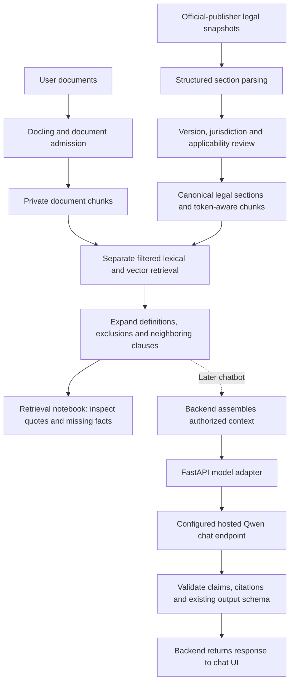

> The internal LLM API is separate from the preserved product backend; see [the service guide](../README.md). Backend AI-worker and retrieval integration remain pending. The current embedding adapter targets hosted Qwen3-Embedding-0.6B; MiniLM measurements below are historical. Legal candidates remain inactive pending review.

# Claimly RAG preparation

**Resume here:** [Next-chat RAG handoff](NEXT_CHAT_HANDOFF.md) — complete current state, code map, latest hosting direction, verification limits and starter prompt.

The single implementation prompt is [RAG_TESTING_PROMPT.md](../parsing/RAG_TESTING_PROMPT.md). It defines supervised evidence retrieval and abstention. Product backend integration and legal activation remain separate milestones.

## Start here

1. Read the [Stage 1 handoff](../parsing/FINAL_STAGE_1.md) and approved document manifest under `../parsing/rag-handoff/`.
2. Read `claimly_legal_corpus_kit/README.txt`, `reports/local_audit.json` and `catalog/retrieval_source_plan.json` inside the kit. The source plan contains 14 inactive starter bundles plus three validation/guidance references. Review eligibility before indexing.
3. Select an authorized embedding runtime, rebuild legal chunks to fit its pinned tokenizer, and compare lexical/dense/fused retrieval. The current adapter uses a hosted endpoint; a local embedding adapter is not implemented. Historically, 1,264 of 1,877 legacy chunks exceeded the old 256-token MiniLM budget; that is not a Qwen measurement.
4. Test source quotes, applicable jurisdictions/versions, missing evidence and private document ownership before adding generation.

## How the source files are used

| Input | Processing | Retrieval role |
|---|---|---|
| User PDF/JPEG/PNG | Existing Docling validation, OCR/layout, relevance and quality gates | Private source evidence, filtered by session/document/version |
| Law XML/HTML and preserved bulk snapshots | Structured parsing; canonical section/subsection text; source/version/applicability review | Public legal collection filtered by jurisdiction, scope and time |
| Legal section JSONL | Verify hashes, broad versus pinpoint citations, missing context and version | Canonical candidate input for new token-aware chunks |
| Existing legal chunks JSONL | Legacy comparison only; rederive mappings and token-aware chunks | Do not silently truncate or assume they are ready |
| Merchant terms/policies | Separate sourced, versioned merchant/product/date review | Contractual context, distinguished from law |
| CSV catalog | Source discovery and coverage audit | Not legal evidence without downloaded, reviewed text |
| Reports, prompts, compliance notes | Development/audit only | Excluded from answer retrieval |

The model receives selected evidence at question time. These files are not automatically training data and do not require model fine-tuning. A legal rule is a candidate basis for reasoning, not proof the individual qualifies. Missing jurisdiction, dates, applicability or conditions remain explicit. Backend owns final deadline calculations.

## What the local audit establishes

350 federal and 987 state records have matching stored text hashes; 1,877 chunks resolve to parent hashes. No duplicate record/chunk IDs were found. This verifies local integrity, not legal correctness. There are eight repeated-text groups and 403 chunk bodies that are not exact parent substrings after legacy whitespace processing. Preserve distinct authorities and rebuild exact mappings.

State text covers 11 jurisdictions unevenly; 69 of 510 state/topic catalog rows have text. NY/GA have none. The federal snapshots identify dates/releases; state version metadata and effective intervals need review. All starter bundles remain inactive until reviewed for a bounded experiment. No legal index, embeddings or chatbot was created during preparation.

## Primary reference sources

- [U.S. Code downloadable releases](https://uscode.house.gov/download.html): pin release points and retain XML.
- [eCFR publication status](https://www.ecfr.gov/reader-aids/understanding-the-ecfr/what-is-the-ecfr): distinguish the government-maintained editorial compilation from publication editions.
- [GovInfo CFR](https://www.govinfo.gov/help/cfr): editions and amendment references.
- [CFPB gift-card regulation and interpretations](https://www.consumerfinance.gov/rules-policy/regulations/1005/20/): candidate cross-check; mirrored law is not independent corroboration.
- [FTC warranty consumer guidance](https://consumer.ftc.gov/articles/warranties): candidate explanatory guidance, tagged separately from binding text.

External pages were inspected on 2026-11-15 for source planning. Their bodies were not added to this corpus; no full current-law or applicability review is claimed. See the kit's source plan for exact local bundles and review gates.
